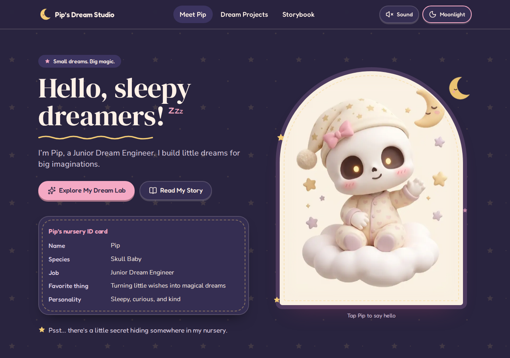

# 🌙 Pip's Midnight Dream Studio

**Small dreams. Big magic. ✨**

A cozy, interactive character portfolio for **Pip, the Skull Baby** — a sleepy, curious, and kind Junior Dream Engineer at the Midnight Nursery.

Built for the **haX.baby — Baby's First Website** hackathon, this project brings Pip's magical world to life through playful interactions, soothing music-box melodies, glowing nightlights, interactive storytelling, and hidden surprises.

## 🌟 Live Demo

- **Website:** https://pip-dream-studio.vercel.app/
- **GitHub Repository:** https://github.com/frostlily2k4/pip-dream-studio

## 🎨 Preview



## ✨ Features

- **Meet Pip:** Discover Pip's personality, character profile, nursery ID card, and friendly reactions.
- **Daydream & Moonlight:** Switch between warm cream and dreamy dark-purple themes.
- **Lullaby Lab:** Explore three synthesized music-box tunes — Starlight, Cloud Nap, and Moon Garden.
- **Nightlight Collection:** Toggle the magical lantern and choose golden, pink, or lavender lighting.
- **Dream Delivery Routes:** Explore an illustrated SVG map and send a dream parcel to different destinations.
- **Interactive Storybook:** Discover Pip's origin story through three illustrated scenes with Previous, Next, and Restart controls.
- **Personality Corner:** Choose Pip's mood — Sleepy, Curious, or Happy — and see Pip respond.
- **Sticker Shelf:** Earn five stickers by exploring the website's interactive features.
- **Hidden Easter Egg:** Discover a secret message by clicking the tiny golden star in the footer constellation three times.
- **Early-Web Nostalgia:** Enjoy playful project windows, retro-style badges, a decorative visitor counter, and sparkle cursor effects.
- **Responsive Design:** Explore Pip's Dream Studio on desktop, tablet, and mobile.

## 🛠️ Tech Stack

- **Framework:** Next.js 15 with App Router
- **UI:** React and TypeScript
- **Styling:** Tailwind CSS v4 and custom CSS
- **Audio:** Web Audio API
- **Illustrations and maps:** Supplied Pip artwork and SVG
- **Icons:** Lucide React
- **Confetti:** canvas-confetti
- **Typography:** DM Serif Display, Fredoka, and Nunito Sans

## 🚀 Getting Started

### Prerequisites

- Node.js compatible with Next.js 15
- npm
- Git (optional, for cloning the repository)

### Installation

Clone the repository:

```bash
git clone YOUR_GITHUB_REPOSITORY_URL
cd pip-dream-studio
```

Install the dependencies:

```bash
npm install
```

Start the development server:

```bash
npm run dev
```

Open [http://localhost:3000](http://localhost:3000) in your browser.

### Available Commands

| Command | Description |
|---|---|
| `npm run dev` | Start the development server |
| `npm run build` | Build the production application |
| `npm run start` | Run the production build |
| `npm run lint` | Run the configured lint checks |
| `npx tsc --noEmit` | Check TypeScript types |

Run the production build before deploying to identify build-time issues.

## 📁 Project Structure

```text
pip-dream-studio/
├── app/
│   ├── page.tsx
│   ├── layout.tsx
│   └── globals.css
├── components/
│   ├── StudioProvider.tsx
│   ├── Header.tsx
│   ├── Hero.tsx
│   ├── Projects.tsx
│   ├── ProjectWindow.tsx
│   ├── LullabyLab.tsx
│   ├── NightlightCollection.tsx
│   ├── DreamDelivery.tsx
│   ├── Storybook.tsx
│   ├── PersonalityCorner.tsx
│   ├── StickerShelf.tsx
│   ├── Footer.tsx
│   ├── SecretStar.tsx
│   └── CursorSparkles.tsx
├── lib/
│   └── audio.ts
├── public/
│   └── images/
├── package.json
├── package-lock.json
└── README.md
```

This tree highlights the main application files. Additional configuration files may be present.

## 🧩 How It Works

`StudioProvider` manages shared application state through the `useStudio()` hook.

- **Theme:** `theme` and `toggleTheme()` control Daydream and Moonlight modes.
- **Sound:** `soundOn` and `toggleSound()` manage the global sound setting, which is off by default.
- **Chimes:** `chime([...])` plays short synthesized sound effects when sound is enabled.
- **Stickers:** `earn(id)` records stickers earned during the current session.

The theme is applied using the `data-theme` attribute on the HTML element. The selected theme is stored in browser `localStorage` under the key `pip-theme`.

The Lullaby Lab generates music-box notes using the Web Audio API, so no external audio files or API keys are required.

## 🌙 Discover the Secret

A tiny golden star is hidden in the footer constellation.

**Click the star three times** to reveal Pip's secret message and a little burst of confetti!

## 🌐 Deployment

This project can be deployed using [Vercel](https://vercel.com/).

1. Push the project to a GitHub repository.
2. Sign in to Vercel and import the repository.
3. Allow Vercel to detect the Next.js framework.
4. Keep the default build settings.
5. Click **Deploy**.
6. Open the live website and test the interactive features.

No environment variables, API keys, database, or custom backend are required for the core experience.

## 🔒 Privacy & Safety

- No account creation is required.
- The website's features do not request visitors' personal information.
- No built-in public chat or advertising feature is included.
- The Daydream/Moonlight preference is stored locally in the browser.
- The sticker shelf resets when the page is refreshed.

Hosting providers and browser infrastructure may still process technical request data under their own policies.

## 🎨 Credits

- **Character artwork:** [Official haX.baby Asset Pack](https://hax.baby/baby/assets/)
- **Character guidelines:** [haX.baby Problem Statement](https://hax.baby/baby-problem)
- **Icons:** [Lucide React](https://lucide.dev/)
- **Confetti effects:** [canvas-confetti](https://github.com/catdad/canvas-confetti)

The supplied Pip artwork is used within the project's visual design. Please consult the original asset pack and applicable usage terms for attribution and permitted use.

## 💗 Made with a Little Moon Dust

Created as a student hackathon project exploring creative frontend development, interactive storytelling, and playful web design.

*Good things start small.* 🌟
